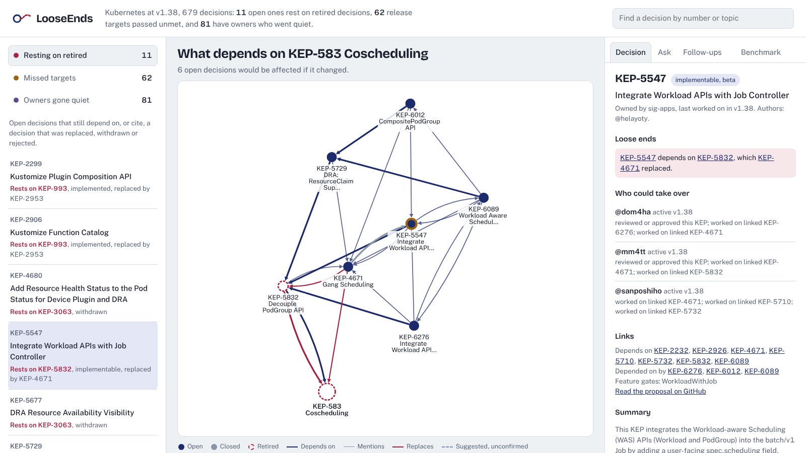

# LooseEnds

**A company brain that finds knowledge which has quietly died.** It finds decisions that changed while the work built on them didn't, promises that passed their deadline, and work whose owners went quiet. Every finding shows the graph path that proves it, names who should pick it up, and can be turned into a follow-up with one click.

Built on **FalkorDB** for [Graph Hacks: Context for AI Agents](https://www.wemakedevs.org/hackathons/falkordb) (WeMakeDevs × FalkorDB, October 2026).

**Tracks entered:** Track 3, Company Brain (primary) · Track 1, Agents That Act on Connected Data

| | |
|---|---|
| Live demo | `<live-demo-url>` |
| Demo video | [docs/media/looseends-demo.mp4](docs/media/looseends-demo.mp4) (2½ minutes, captioned) |
| MCP endpoint | `<live-demo-url>/mcp` (streamable HTTP), or `python -m looseends.mcp_server` (stdio) |
| Write-up | [docs/blog.md](docs/blog.md) |



## The problem

Company knowledge rarely goes missing. It goes **stale** (a decision changed; the plans that rely on it didn't), **orphaned** (its owner left) or **unkept** (a promised date passed and nobody noticed). Search can't see any of this, because each document looks fine on its own. The problem lives in the **connections** between records. LooseEnds puts those connections in a graph and walks them.

Existing tools flag stale content by age or usage. LooseEnds flags it by **cause**: "this is wrong *because that* changed."

## What it does, on real data

The data is all **679 Kubernetes Enhancement Proposals (KEPs)**, the public design decisions of the Kubernetes project: **722 people, 38 teams**, with authors, reviewers, approvers, release targets, feature gates and links between decisions.

| Feature | What it answers | Result on the data |
|---|---|---|
| Stale detector | Which open decisions still rest on one that was replaced, withdrawn or rejected? | 11 found |
| Missed-target detector | Which decisions promised a stage by a release that already shipped? | 62 found |
| Orphan detector | Which open decisions have only authors who went quiet for 4+ releases? | 81 found |
| Ripple (what-if) | If this decision changes, which open work is affected, by which path, owned by whom? | KEP-583 → 6 open decisions |
| Who can take over | Which active people are closest to this decision, and why? | Top 3 with reasons |
| In force today | Which decision replaced this one, through the whole chain? | 583 → 5832 → 4671 |
| Suggested links | Which decisions are likely related although nobody said so? | 119, shown as unconfirmed |
| Agent | Answers in plain English using only graph tools, and shows every call it made | Groq or no-key planner |
| Follow-ups | Drafts a message to the right active person; a human approves it | Stored in the graph |
| MCP server | Lets other agents call `impact_of`, `who_knows`, `in_force` and more | stdio and HTTP |

**Example:** *Coscheduling* (KEP-583) was replaced by *Decouple PodGroup API* (KEP-5832), which was itself replaced by *Gang Scheduling* (KEP-4671). Three open proposals (KEP-5547, 5729 and 6276) still list KEP-5832 as a dependency. LooseEnds flags them, shows the path, and suggests @dom4ha, who reviewed KEP-5832 and worked on two of the dependent proposals.

## Benchmark: does the graph help?

The 295 links that KEP authors declared between decisions were **hidden** from a copy of the graph. Each method then ranked all 677 other KEPs for every KEP with a declared link.

| Method | Top 1 | Top 5 | Top 10 | MRR |
|---|---|---|---|---|
| Text similarity alone (TF-IDF, title + summary) | 0.34 | 0.60 | 0.70 | 0.56 |
| Graph signals alone (people, gates, teams, mentions) | 0.32 | 0.66 | 0.76 | 0.59 |
| **Graph + text** | **0.43** | **0.79** | **0.89** | **0.69** |

**Graph + text finds 89% of hidden links in its top 10, against 70% for text search alone.**

- **No tuning on the test links:** graph weights were fixed before testing, and the single text weight was chosen by 2-fold cross-validation.
- **Signal ablations:** the per-signal breakdown is in [benchmark/RESULTS.md](benchmark/RESULTS.md).
- **Suggested links:** the same method powers them in the app. 45% of suggestions with no textual mention match a link the authors declared themselves (chance is about 0.06%). That's a lower bound, so they are always shown as unconfirmed.

Reproduce: `python -m looseends.benchmark`

## Graph data model

```
(:Person {handle, last_active})
   -[:AUTHORED | REVIEWED | APPROVED]->
(:Decision {number, title, status, stage, latest, latest_estimated,
            active, retired, summary, url, created, updated})

(:Decision)-[:OWNED_BY]->(:Team {name})               owning team (SIG)
(:Decision)-[:INVOLVES]->(:Team)                      participating teams
(:Decision)-[:GATED_BY]->(:FeatureGate {name})
(:Decision)-[:TARGETS {stage}]->(:Release {minor, name})
(:Decision)-[:DEPENDS_ON {source, confidence}]->(:Decision)       declared (see-also)
(:Decision)-[:CITES {source, confidence}]->(:Decision)            mentioned in proposal text
(:Decision)-[:REPLACES {source}]->(:Decision)                     replaces / superseded-by
(:Decision)-[:LIKELY_RELATED {score, confidence, reasons}]->(:Decision)   inferred, unconfirmed

(:FollowUp {id, status, reason, message, created})
   -[:ABOUT]->(:Decision), -[:ASSIGNED_TO]->(:Person)             written by the agent
(:AgentRun {question, answer, mode, at, tools})-[:ABOUT]->(:Decision)   agent memory
(:Meta {key: 'current_release', value})
```

**Size:** 679 Decision, 722 Person, 450 FeatureGate, 39 Release and 38 Team nodes; about 8,000 edges.

**Indexes:** range indexes on `Decision.number`, `Person.handle`, `Team.name`, `FeatureGate.name` and `Release.minor`, plus a full-text index on `Decision.title` and `Decision.summary`.

**Derived properties,** computed in the graph at load time:
- `Decision.active`: status is provisional or implementable, so work is still open.
- `Decision.retired`: status is replaced, withdrawn, rejected, superseded, removed or deferred, **or** another decision `REPLACES` it.
- `Decision.latest`: the last release the decision was worked in. When a KEP lists no milestone, it is estimated from dates, and `latest_estimated` is set.
- `Person.last_active`: the most recent `latest` of any decision the person touched.

## Cypher queries and graph algorithms

All queries are in [`looseends/detectors.py`](looseends/detectors.py), [`looseends/tools.py`](looseends/tools.py) and [`looseends/benchmark.py`](looseends/benchmark.py). The core ones:

**Stale.** Open decisions linked to a retired one, with its replacement:
```cypher
MATCH (d:Decision)-[link:DEPENDS_ON|CITES]->(old:Decision)
WHERE d.active AND NOT d.retired AND old.retired
OPTIONAL MATCH (new:Decision)-[:REPLACES]->(old)
RETURN d.number, type(link), old.number, old.status, collect(DISTINCT new.number) AS replaced_by
```

**Ripple.** Everything up to 3 hops downstream, at its shortest distance:
```cypher
MATCH p = (hit:Decision)-[:DEPENDS_ON|CITES*1..3]->(x:Decision {number: $n})
WHERE hit.number <> $n
WITH hit, min(length(p)) AS hops
RETURN hit.number, hit.title, hit.active AND NOT hit.retired AS open, hops
```
Ranked with FalkorDB's built-in PageRank:
```cypher
CALL algo.pageRank('Decision', 'DEPENDS_ON') YIELD node, score
```

**Missed targets.** A release target that shipped without the decision reaching that stage:
```cypher
MATCH (d:Decision)-[t:TARGETS]->(r:Release)
WHERE NOT d.retired AND d.status <> 'implemented' AND r.minor < $current
  AND NOT (t.stage = 'stable' AND d.stage = 'stable')        // plus the alpha and beta rules
WITH d, t.stage AS promised, max(r.minor) AS due
RETURN d.number, promised, due, $current - due AS releases_late
```

**Orphans.** Open decisions whose newest-active author is 4+ releases quiet:
```cypher
MATCH (p:Person)-[:AUTHORED]->(d:Decision)
WHERE d.active AND NOT d.retired
WITH d, collect(p) AS authors, max(p.last_active) AS newest
WHERE newest <= $current - 4
RETURN d.number, [a IN authors | a.handle], newest
```

**Who can take over.** Weighted graph signals; only people active in the last 2 releases count:
```cypher
// reviewed or approved this decision (weight 3)
MATCH (p:Person)-[:REVIEWED|APPROVED]->(d:Decision {number: $n}) WHERE p.last_active >= $since ...
// worked on a linked decision (2)
MATCH (d:Decision {number: $n})-[:DEPENDS_ON|CITES]-(near)<-[:AUTHORED|APPROVED]-(p:Person) ...
// authored a decision sharing a feature gate (2)
MATCH (d)-[:GATED_BY]->(f:FeatureGate)<-[:GATED_BY]-(near)<-[:AUTHORED]-(p:Person) ...
// approves in the same team (1)
MATCH (d)-[:OWNED_BY]->(t:Team)<-[:OWNED_BY]-(near)<-[:APPROVED]-(p:Person) ...
```

**In force today.** Follow `REPLACES` forward:
```cypher
MATCH (start:Decision {number: $n})
OPTIONAL MATCH p = (newest:Decision)-[:REPLACES*1..5]->(start)
RETURN coalesce(newest.number, start.number) AS in_force, nodes(p)
```

**Search.** The full-text index, any word matching:
```cypher
CALL db.idx.fulltext.queryNodes('Decision', $q) YIELD node, score
```

**Benchmark features.** All computed in FalkorDB, for example shared contributors weighted Adamic-Adar style:
```cypher
MATCH (a:Decision)<--(p:Person)-->(b:Decision) WHERE a <> b
WITH DISTINCT a, b, p
RETURN a.number, b.number, sum(1.0 / log(p.deg + 1.0)) AS score
```

**The agent's Cypher tool** runs through `GRAPH.RO_QUERY`, so the database itself refuses writes.

The graph is the product. Without FalkorDB there is nothing to traverse, so no detector, ripple, expert ranking or agent answer exists.

## Architecture

```
kubernetes/enhancements ──parse──▶ data/keps.json ──load──▶ FalkorDB graph
                                         │                     ▲   ▲
                     infer (graph+text) ─┘                     │   │ Cypher
                     data/inferred.json ──LIKELY_RELATED───────┘   │
                                                                   │
  Web UI (FastAPI + Cytoscape) ──▶ detectors & tools ──────────────┤
  Agent (Groq tool calling, or rule-based planner) ──▶ tools ──────┤
  MCP server (stdio and HTTP /mcp) ──▶ tools ──────────────────────┘
```

| Path | Purpose |
|---|---|
| `looseends/ingest_keps.py` | Parse KEPs, write the snapshot, load the graph |
| `looseends/detectors.py` | Stale, missed targets, orphans, ripple, experts, in force |
| `looseends/tools.py` | Graph tools shared by the agent, web app and MCP server |
| `looseends/agent.py` | Tool-calling agent (Groq or any OpenAI-compatible API) and no-key planner; saves each run to the graph |
| `looseends/mcp_server.py` | MCP server |
| `looseends/web.py` and `looseends/static/` | API and single-page UI |
| `looseends/benchmark.py` and `looseends/infer.py` | Hidden-link benchmark and suggested links |
| `tests/` | Detector, agent and LLM-loop tests on a small known graph |
| `scripts/record_demo.py` | Re-records the demo video from the running app |

## Setup

**Requirements:** Python 3.10+. The repo includes a parsed snapshot of the KEPs (`data/keps.json`), so no other download is needed.

```bash
git clone https://github.com/aayushsinghthapa-cloud/looseends && cd looseends
pip install -r requirements.txt
uvicorn looseends.web:app --port 7860
# open http://localhost:7860  (the graph builds itself on first start, about 6 seconds)
```

**FalkorDB:** by default LooseEnds runs FalkorDB embedded through [falkordblite](https://pypi.org/project/falkordblite/), which bundles the FalkorDB engine, so no Docker is needed. To use a FalkorDB server instead (Docker, self-hosted or FalkorDB Cloud), set `FALKORDB_HOST`, plus `FALKORDB_PORT`, `FALKORDB_USERNAME` and `FALKORDB_PASSWORD` if needed:

```bash
docker run -p 6379:6379 -p 3000:3000 -it --rm falkordb/falkordb:latest
export FALKORDB_HOST=localhost
```
With a server, open FalkorDB Browser at `http://localhost:3000` to explore the `looseends` graph.

**Agent:** the agent answers with the built-in planner by default. For plain-English answers from a language model, set a Groq key (free at console.groq.com):
```bash
export GROQ_API_KEY=gsk_...
# optional: LOOSEENDS_MODEL (default openai/gpt-oss-120b); LLM_BASE_URL and LLM_API_KEY for any OpenAI-compatible API
```

**Docker:**
```bash
docker build -t looseends . && docker run -p 7860:7860 -e GROQ_API_KEY=$GROQ_API_KEY looseends
```

**Command line:**
```bash
python -m looseends load                     # rebuild the graph from data/keps.json
python -m looseends scan                     # every detector
python -m looseends ripple 583               # what-if KEP-583 changes
python -m looseends experts 5832             # who could take over KEP-5832
python -m looseends current 583              # which decision is in force now
python -m looseends.agent "who can take over KEP-1845"
```

**MCP client config (stdio):**
```json
{ "mcpServers": { "looseends": { "command": "python", "args": ["-m", "looseends.mcp_server"], "cwd": "/path/to/looseends" } } }
```

**Refresh the data, benchmark and tests:**
```bash
pip install -r requirements-dev.txt
git clone --depth 1 https://github.com/kubernetes/enhancements data/enhancements
python -m looseends load data/enhancements    # re-parse and refresh data/keps.json
python -m looseends.infer                     # refresh data/inferred.json
python -m looseends.benchmark                 # refresh benchmark/results.json
python -m pytest tests
```

## Deployment

The live demo runs on Hugging Face Spaces from the `Dockerfile`. To deploy your own copy:
1. Create a Docker Space.
2. Optionally, add `GROQ_API_KEY` as a secret.
3. Run `HF_TOKEN=... ./deploy/push_to_hf.sh <hf-username>`.

## Limitations

- **"Inactive" isn't "left":** it means no KEP involvement for 4+ releases, not that someone left the project.
- **Estimated activity dates:** decisions that list no milestone get an activity release estimated from their dates, flagged with `latest_estimated`.
- **`CITES` links are loose:** they come from proposal text and can be passing mentions, so they carry lower confidence than declared `DEPENDS_ON` links.
- **Suggested links are inferences:** they are kept separate and never treated as fact by the detectors or the agent.
- **Follow-ups stay in the graph:** they are stored but never sent anywhere. Sending would be a connector to Slack or GitHub after approval.

## AI use disclosure

AI coding assistants were used during development: for research, drafting code and tests, and reviewing output. All code was run and checked against the real data, and the design, graph model and queries are documented above.

## License

MIT. KEP data © The Kubernetes Authors, Apache-2.0. Cytoscape.js (MIT), Bricolage Grotesque and Public Sans (SIL OFL) are bundled in `looseends/static`.
